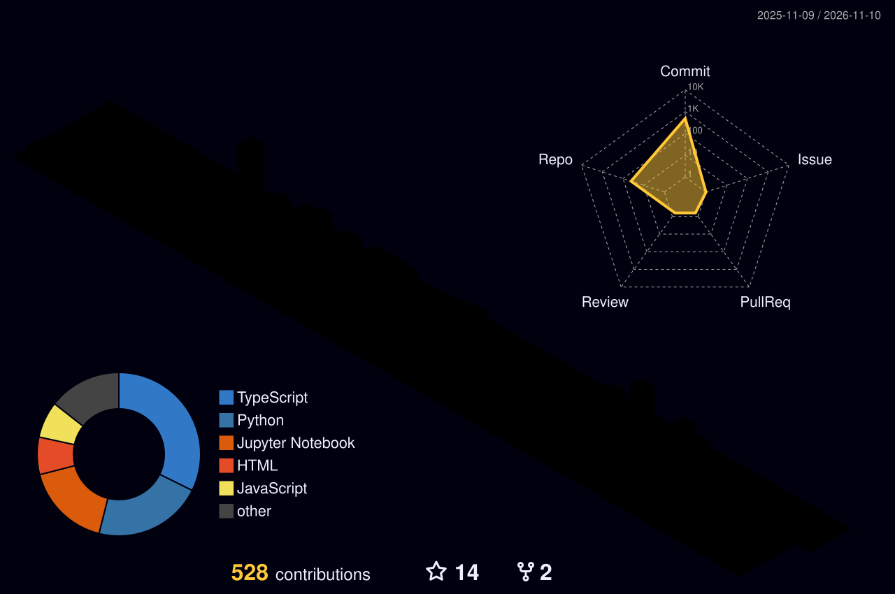

<!-- GitHub Profile README | Siddharthchandra123 | Refreshed October 2026 -->

**B.Tech in Computer Science (AI & ML) · ABES Engineering College, India**

*Building practical AI products, open infrastructure, and developer communities.*

---

## 👋 The short version

I'm an AI/ML student and hands-on developer interested in the intersection of **agentic AI, real-time speech systems, large language models, distributed systems, and GPU infrastructure**. I enjoy taking projects beyond notebooks: creating APIs, dashboards, infrastructure, telemetry, tests, and reproducible demos.

- 🏆 **1st place — AMD AI Engage 2026, North & East India** ($5,000 award).
- 👥 **Founder & President — AI Developer Society**, building a peer-learning and project community.
- ⚡ **AMD Instinct MI300X + ROCm:** built and tested self-hosted AI inference and voice-agent workflows.
- 🧠 **Currently exploring:** multimodal agents, AI Factory orchestration, GPU observability, RAG, and data platforms.
- 🧩 **Problem solving:** 120+ LeetCode problems and 100+ CodeChef problems.

> **My approach:** Prototype fast. Validate carefully. Document what works — and what still doesn't.

## 🚀 Featured engineering projects

| Project | What I built / am building | Stack |
|:--|:--|:--|
| 🎙️ **[AMD MI300X Voice Agent](https://github.com/Siddharthchandra123/AMD_Voice_agent)** | Self-hosted speech-to-text → LLM → speech pipeline, with modular services and retrieval support. Functional MVP; hardening in progress. | AMD MI300X, ROCm, Whisper, vLLM, Kokoro, Qdrant, FastAPI |
| ⚙️ **[AMD AI Factory Mission Control](https://github.com/Siddharthchandra123/AMD-AI-Factory)** | Inference job scheduling, worker telemetry, simulation and authenticated MI300X execution. A release-candidate technical demo, not a production multi-GPU platform. | Python, FastAPI, Next.js, PostgreSQL, Docker, AMD SMI, vLLM |
| 🩺 **[AI Chikitsalya](https://github.com/Siddharthchandra123/AI_chikitsalya_PHC)** | Healthcare-information assistant combining predictive ML and retrieval-based question answering. Designed as an assistance tool, not a substitute for clinical decisions. | Scikit-learn, SentenceTransformers, FAISS, Python |
| 🗃️ **[Db2 → PostgreSQL Migration Platform](https://github.com/Siddharthchandra123/DataBase-Migration-Tool)** | Schema discovery, dependency-aware migration plans, batch moves, and target validation. Proof of concept; constraint fidelity is still being improved. | IBM Db2, PostgreSQL, FastAPI, React, Docker |
| 🧠 **[MiniGPT](https://github.com/Siddharthchandra123/MiniGPT)** | Explorations in building a small GPT-style language model and related NLP tooling from the ground up. | Python, PyTorch, Tokenization, Transformers |
| 🤝 **[AI Developer Society Platform](https://github.com/Siddharthchandra123/AI_dev_society)** | Club operations prototype with membership, events, submissions, approvals, and a leaderboard. | Flask, SQLite, Web UI |

<b>🔬 More from my lab</b>

 

- **MUSE Nova — multimodal personal AI assistant:** bringing together text, voice, document understanding, optional screen context, web tools, and agent workflows. *Active development; some components remain under integration testing.*
- **Open-source AI + data experimentation:** retrieval-augmented generation, model fine-tuning, reinforcement-learning environments, and open lakehouse architecture.
- **[More public repositories →](https://github.com/Siddharthchandra123?tab=repositories)**

## 🧰 Engineering toolkit

**Languages & app development**

**ML, AI & data**

**Infrastructure & workflow**

`ROCm` · `AMD MI300X` · `vLLM` · `Whisper` · `Kokoro TTS` · `RAG` · `FAISS` · `Qdrant` · `Apache Spark` · `Apache Iceberg` · `IBM Cloud` · `LangGraph`

## 🏅 Milestones & community

| Highlight | Details |
|:--|:--|
| 🥇 **AMD AI Engage 2026** | First place, **North & East India**; $5,000 award |
| 🎓 **Academic journey** | B.Tech CSE (AI & ML), ABES Engineering College |
| 🌱 **Leadership** | Founder & President, **AI Developer Society** |
| 🛠️ **Hackathon experience** | **Top 40**, IIT BHU pre-zonals; built an off-road semantic segmentation solution |
| 💻 **DSA practice** | 120+ LeetCode and 100+ CodeChef problems |

## 📊 GitHub activity, visualized

<!-- Hosted image generators may occasionally rate limit. These are live visualizations, not hand-entered scores. -->

### Contribution timeline

### Commit patterns & developer activity

> **How to interpret the charts:** Language charts reflect repository/commit data, **not skill level**. Contributions may omit private activity and depend on GitHub's contribution rules. Third-party image providers can occasionally fail or show cached data.

### 🏙️ 3D contribution calendar

<!-- Generated by .github/workflows/profile-3d.yml; initially blank until the workflow runs successfully. -->

Generated by GitHub Actions. Run <code>GitHub-Profile-3D-Contrib</code> once after installation to create the SVG.

### 🐍 Contribution snake

<picture>
  <source media="(prefers-color-scheme: dark)" srcset="https://raw.githubusercontent.com/Siddharthchandra123/Siddharthchandra123/output/github-contribution-grid-snake-dark.svg" />
  <source media="(prefers-color-scheme: light)" srcset="https://raw.githubusercontent.com/Siddharthchandra123/Siddharthchandra123/output/github-contribution-grid-snake.svg" />
  
</picture>

Automatically refreshed by the <code>GitHub-Contribution-Snake</code> Action.

## 🎯 What's next

- Make **real-time voice and multimodal agents** more responsive, safe, and useful.
- Extend **GPU job orchestration** with robust scheduling experiments and observability.
- Explore **open lakehouse + AI** workflows for data preparation, retrieval, and analytics.
- Keep contributing to **open source** and building with the **AI Developer Society** community.

## 🤝 Let's connect

**Interested in AI engineering, infrastructure, open source, or developer communities? Let's build something useful.**

